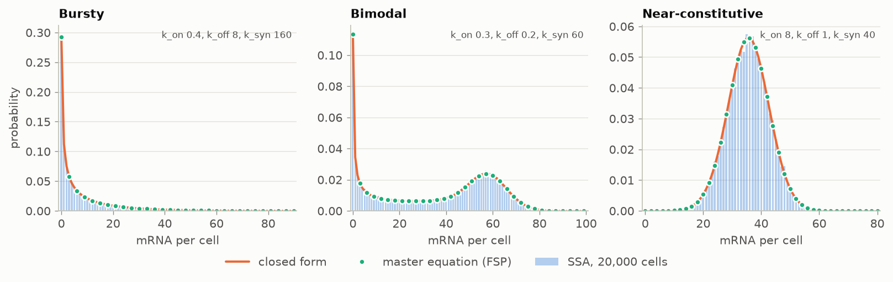
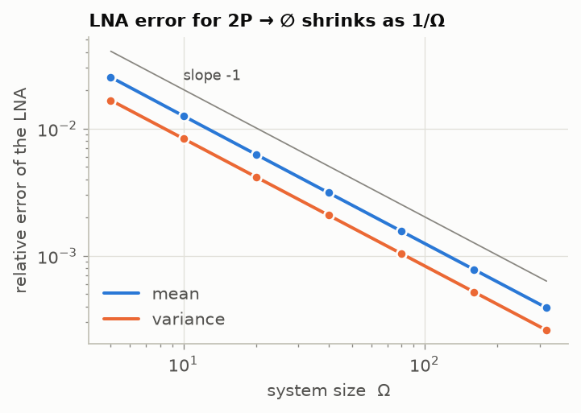
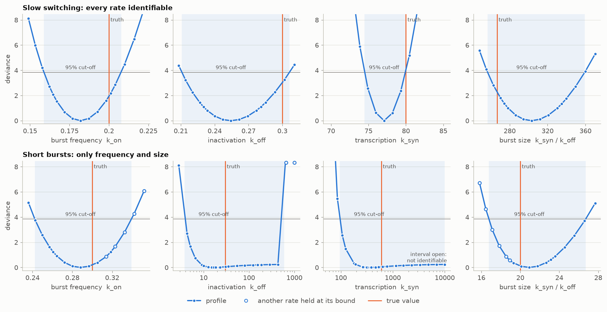
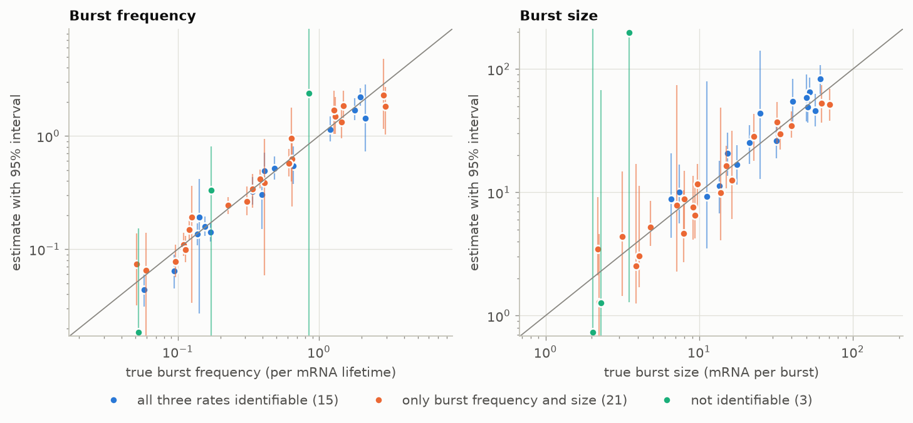
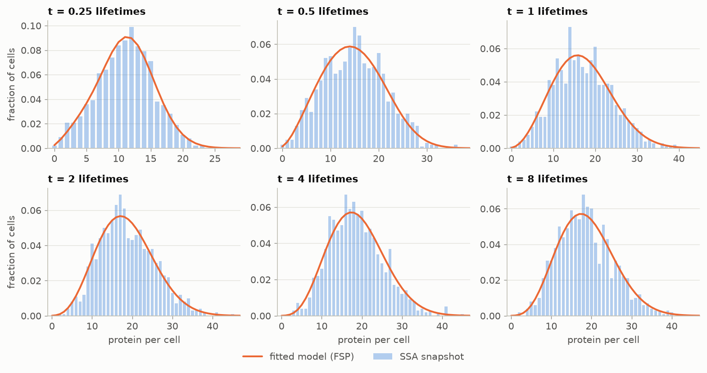

# burstkin

**Transcriptional bursting from single-cell counts.** Exact stochastic simulation,
three solvers for the chemical master equation, the linear noise approximation,
and likelihood inference of burst frequency and burst size with honest
uncertainty. Each piece is checked against an independent one.

Most genes are transcribed in bursts: the promoter flips on, fires off a batch
of mRNAs, and flips off again. How often it fires (burst frequency) and how much
it makes each time (burst size) are regulated separately, and both leave a
signature in the cell-to-cell distribution of transcript counts. Reading that
signature back out of single-cell data is an inverse problem with three traps:

1. molecule capture in sequencing is incomplete and differs from cell to cell;
2. some kinetic parameters cannot be determined from snapshot data at all;
3. realistic gene circuits (feedback, nonlinear binding) have no closed-form
   distribution.

`burstkin` handles all three: an exact capture-aware likelihood, profile
likelihood to separate what the data determine from what they don't, and a
finite-state-projection likelihood for models without a closed form.

> Research and teaching software. The mathematics is in [docs/theory.md](docs/theory.md).

## Quick start

```bash
cd burstkin
python -m venv .venv
.venv\Scripts\activate                # macOS/Linux: source .venv/bin/activate
pip install -e ".[dev]"

burstkin validate                      # 15 cross-checks, about 15 seconds
burstkin gene --k-on 0.3 --k-off 0.4 --k-syn 60     # simulate one gene, recover its kinetics
burstkin demo -o demo_output           # 40-gene experiment: simulate, fit, plot (~8 min on 4 cores)
pytest                                 # test suite
```

## What is inside

| Module | What it does |
|---|---|
| `network` | Reaction networks with stochastic mass-action propensities (`C(x, r)` combinatorics) and their macroscopic limits |
| `models` | Telegraph (two-state promoter), birth-death, `2P -> 0` annihilation, negative autoregulation |
| `ssa` | Gillespie's direct method, vectorised across cells; binomial molecule capture |
| `fsp` | Finite state projection of the master equation: reachability-based state space, conservation-law bounds by linear programming, stationary solver, and three transient solvers (uniformization, dense matrix exponential, scipy's `expm_multiply`) |
| `analytic` | Closed-form telegraph distribution via a positive Kummer series with rigorous truncation bounds and exact gradients; moments and their inversion; bursty (negative binomial) and constitutive (Poisson) limits |
| `lna` | Rate equations and the linear noise approximation, solved in the stoichiometric subspace so conservation laws are handled exactly |
| `inference` | Capture-aware maximum likelihood, profile-likelihood intervals, identifiability calls, and Poisson/NB/telegraph model comparison with boundary-corrected likelihood-ratio tests |
| `fsp_inference` | Likelihood of time-course snapshot data from the master equation, for models without a closed form |
| `scdata`, `pipeline` | Count-matrix I/O (CSV, TSV, 10x MatrixMarket), capture estimation, simulated experiments, parallel gene-by-gene analysis |
| `validate` | The cross-checks behind `burstkin validate` |

## Results

All figures and numbers below are produced by `python scripts/make_figures.py`
(seeded) and `burstkin validate --full`.

### Three ways to solve the same model agree



The telegraph model's stationary distribution in three regimes, from 20,000
exactly simulated cells, from the closed form, and from the truncated master
equation. The closed form and the master equation agree to 1e-14 in every
regime. Chi-square goodness-of-fit tests of the simulations against them give
p = 0.74, 0.58 and 0.64.

### Where the linear noise approximation stops being exact



For linear networks such as the telegraph model, the LNA's mean and variance are
exact at all times, and they match the master equation to 1e-12. For the
bimolecular reaction `2P -> 0` they are not. The master equation gives a mean
of `Omega + 1/8 + O(1/Omega)` where the LNA predicts `Omega`, so the LNA's
relative error falls as `1/Omega` (measured slope -1.003).

### Burst kinetics with honest uncertainty



There are two simulated genes, 1,000 cells each, with capture efficiency that
varies between cells (mean 30%). Each curve is a profile likelihood; the
shaded band is the 95% interval it implies.

- **Slow switching (top row).** Every profile crosses the cut-off on both sides,
  so all three rates are identifiable.
- **Short, rare bursts (bottom row).** Burst frequency and burst size are still
  pinned down (burst size 20.9, interval 16.8 to 26.7, truth 20). But `k_syn`
  runs flat into its bound: the counts determine the ratio `k_syn / k_off`, not
  how long each burst lasts.

Hollow points mark where another rate is held at its bound. The apparent upper
end of the `k_off` interval (about 600) is an artifact of `k_syn` hitting its
ceiling, which is why the identifiability call profiles both rates.

Seven of the eight intervals contain the true value. The eighth (`k_syn`, top
row: 74.4 to 79.96 against a true 80) misses narrowly, which 95% intervals are
expected to do about one time in twenty.

### A 40-gene experiment with molecule loss



The simulated experiment has 40 genes, with kinetics drawn across the ranges
reported for mammalian genes, measured in 600 cells. Capture efficiency varies
between cells (mean 30%, coefficient of variation 25%). It was *estimated* from
library sizes, as it must be with real data, and the estimates correlate 0.68
with the truth.

| outcome | genes |
|---|---|
| skipped for low expression | 1 |
| all three rates identifiable | 15 |
| burst frequency and size only | 21 |
| not identifiable | 3 |

For the 36 identifiable genes:

| | median error | 95% interval contains the truth |
|---|---|---|
| burst frequency | 1.15-fold | 33 of 36 |
| burst size | 1.25-fold | 34 of 36 |

The whole analysis took 8 minutes on 4 cores of a laptop (`burstkin demo` runs
the same pipeline).

### A gene circuit with no closed form



A gene that represses itself (its protein binds its own promoter, a
bimolecular and therefore nonlinear step) was simulated in 1,000 cells at each
of six times after induction. All four rates were then fitted to the protein
snapshots through the master equation:

| rate | meaning | truth | estimate | 95% interval |
|---|---|---|---|---|
| `rho_u` | output of the free promoter | 60 | 61.9 | 59.8 - 64.1 |
| `rho_b` | leaky output of the repressed promoter | 4 | 4.10 | 2.69 - 6.25 |
| `sigma_b` | repressor binding (per protein) | 0.4 | 0.406 | 0.361 - 0.457 |
| `sigma_u` | repressor unbinding | 3 | 2.97 | 2.48 - 3.56 |

The truncated master equation gives a rigorous lower bound on the likelihood
(truncation error 4e-15 here). The leak rate is the hardest to pin
down. Its interval spans a factor of 2.3, against 1.07 for the free-promoter
output, because leaky expression barely changes the protein snapshots.

## Validation

`burstkin validate --full` compares every method with an independent one:

| check | compared against | result | required |
|---|---|---|---|
| Kummer series for `log 1F1` | 40-digit mpmath, 200 random points over 6 decades | 1.6e-15 | < 1e-12 |
| fast many-cell likelihood and gradient | the general series | 1.4e-12 | < 1e-9 |
| analytic likelihood gradient | central finite differences | 1.6e-8 | < 1e-5 |
| closed-form distribution | Gauss-Jacobi quadrature over the Beta mixing law | 2.5e-11 | < 1e-10 |
| master equation (FSP), stationary | closed form, three regimes | 6.7e-14 | < 1e-12 |
| master equation (FSP), transient | exact birth-death solution | 4.5e-15 | < 1e-12 |
| uniformization | dense matrix exponential and scipy's `expm_multiply`, nonlinear model | 8.2e-15 | < 1e-12 |
| LNA, linear network | exact moments, stationary and transient | 2.3e-12 | < 1e-8 |
| LNA, `2P -> 0` | its predicted error order (log-log slope, `Omega` = 40 to 320) | -1.0007 | -1 +/- 0.02 |
| exact simulation, 20,000 cells | closed form (chi-square p-value) | 0.70 | > 0.001 |
| exact simulation, feedback model | master equation at 4 times (Bonferroni p-value) | 1.0 | > 0.001 |
| binomial capture of the FSP solution | Poisson-Beta with `k_syn * s` | 1.3e-15 | < 1e-12 |
| capture-scale invariance | halved efficiencies: `k_syn` doubles, switching rates fixed | 5.8e-7 | < 1e-4 |
| moment inversion | exact factorial moments | 1.0e-13 | < 1e-10 |
| MLE, 20,000 cells | true burst frequency and size (relative error) | 0.008 | < 0.06 |
| 95% profile intervals | coverage over 200 simulated data sets: burst frequency / burst size | 0.95 / 0.96 | 0.895 - 0.99 |
| feedback model from time course | truth, in standard errors (max over 3 rates) | 1.12 | < 3.5 |

Numbers are differences between methods unless stated. The quick checks
take about 15 seconds; the last two take about 8 minutes.

## Using it on your own data

```bash
# cells as rows, genes as columns (CSV/TSV), or a 10x matrix.mtx with features.tsv and barcodes.tsv
burstkin fit counts.csv --mean-capture 0.1 -j 4 -o burst_kinetics.csv
burstkin fit filtered_feature_bc_matrix/matrix.mtx --genes-in-rows --mean-capture 0.1 -j 4
burstkin fit counts.csv --capture-file capture.csv          # known per-cell efficiencies
```

MatrixMarket files stay sparse; genes are densified a block at a time, so a
full 10x matrix does not need to fit in memory as a dense array. Per-cell
capture efficiencies are estimated from library size and scaled to the mean
you supply. The absolute scale cannot be learned from counts: a wrong mean
rescales every `k_syn` and burst size by the same factor, but leaves burst
frequency and `k_off` unchanged (one of the validation checks). The output has
one row per gene: the estimates, 95% profile intervals (blank where an interval
is open), BIC for the Poisson, negative-binomial and telegraph models, and the
identifiability class.

From Python:

```python
from burstkin.inference import TelegraphLikelihood, fit_telegraph, profile_likelihood

lik = TelegraphLikelihood(counts, capture)          # counts: one gene across cells
fit = fit_telegraph(counts, capture, likelihood=lik)
size = profile_likelihood(lik, fit, "burst_size")
print(fit.burst_frequency, fit.burst_size, size.ci)
```

More in [examples/](examples/).

## Project layout

```
src/burstkin/        the package (modules above), CLI in cli.py
tests/               pytest suite; `pytest -m slow` adds the coverage study
scripts/             make_figures.py regenerates docs/images and docs/results.json
examples/            single_gene.py, feedback_timecourse.py
docs/theory.md       derivations, numerical methods, identifiability, references
```

## Limitations

- Genes are analysed independently; shared extrinsic noise enters only through
  capture efficiency.
- Two promoter states. Genes with more complex promoters show up as poor fits
  (see the model comparison columns), not as silently wrong numbers.
- Snapshot inference for the telegraph model assumes steady state. The
  time-course likelihood relaxes this, at higher cost.

## References

Gillespie 1977 (exact simulation); Peccoud & Ycart 1995 (telegraph
distribution); Munsky & Khammash 2006 (finite state projection);
van Kampen 2007 (linear noise approximation); Raue et al. 2009 (profile
likelihood and identifiability); Kim & Marioni 2013 and Larsson et al. 2019
(burst kinetics from single-cell data). Full citations in
[docs/theory.md](docs/theory.md#references).

## License

MIT. See [LICENSE](LICENSE).
